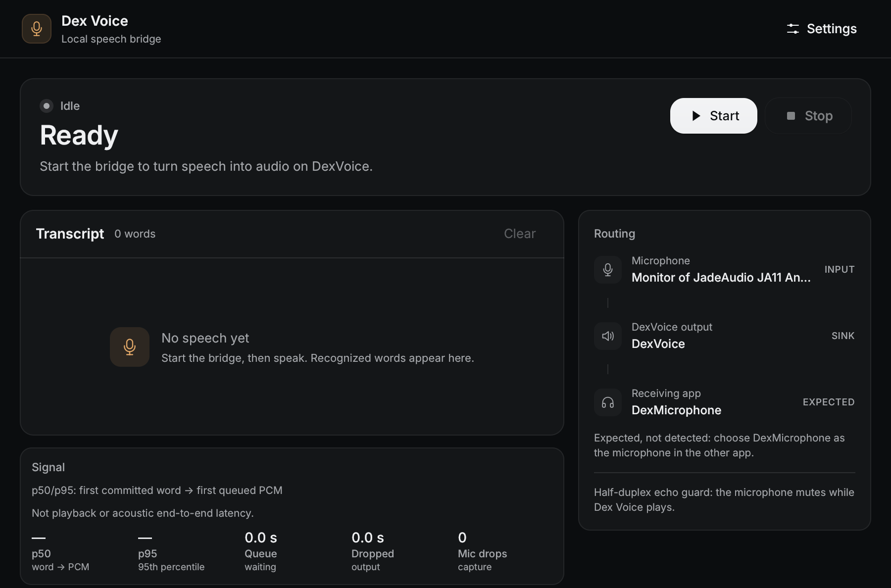
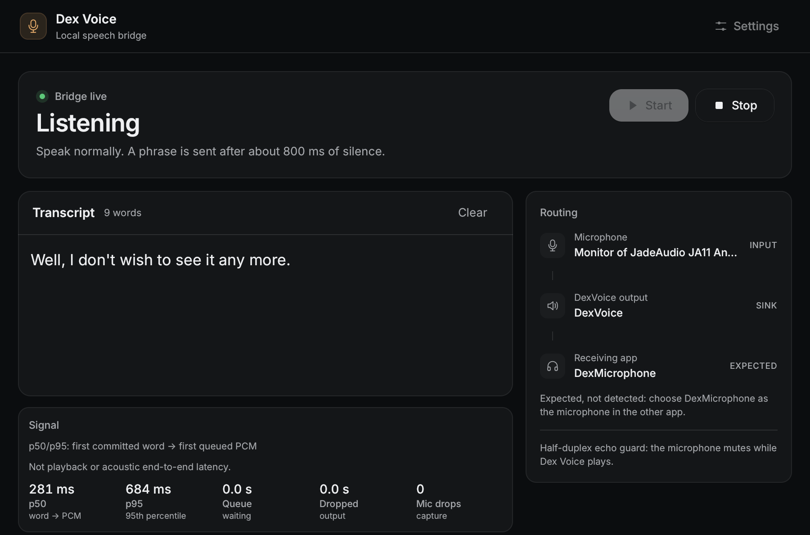
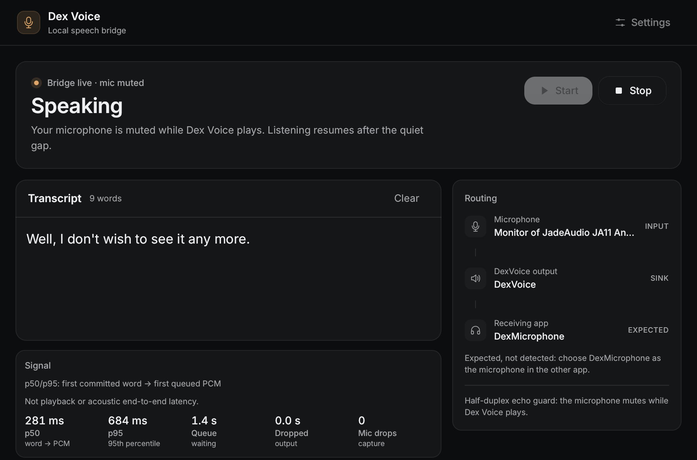
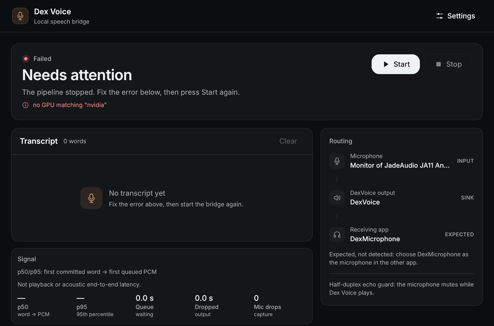
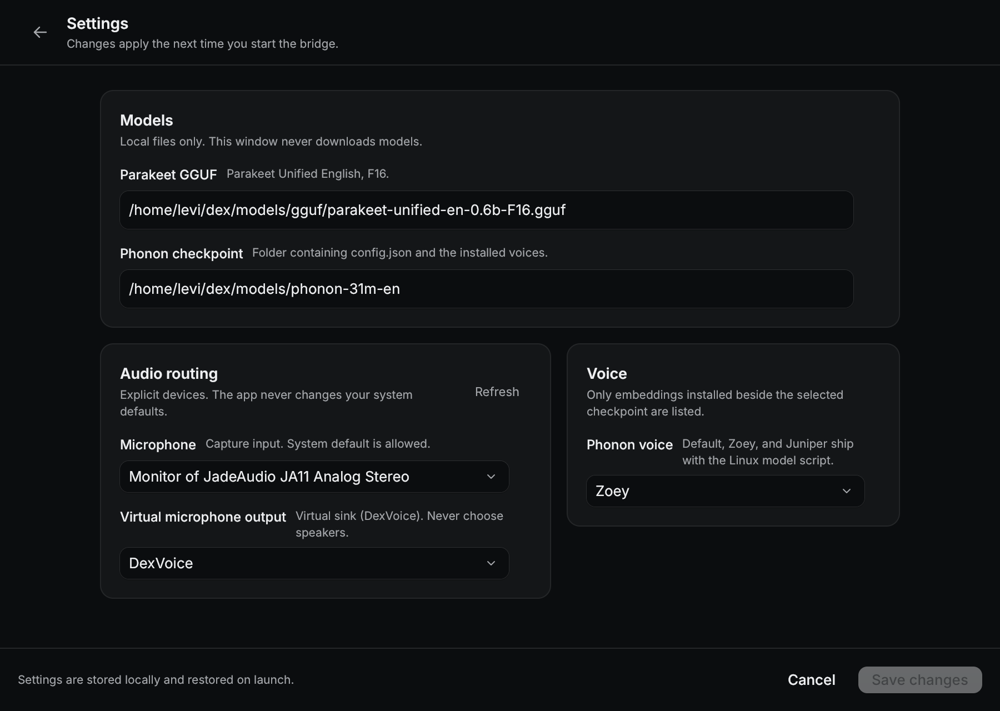
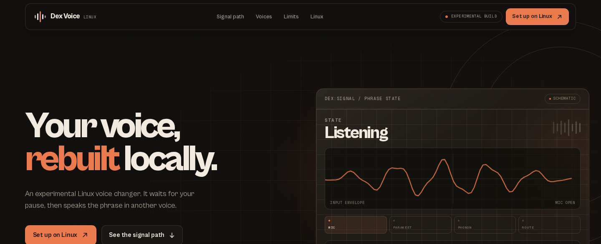
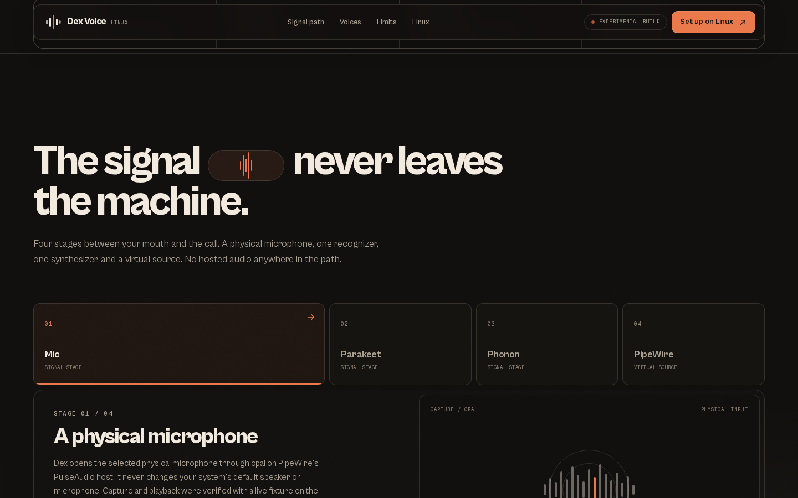
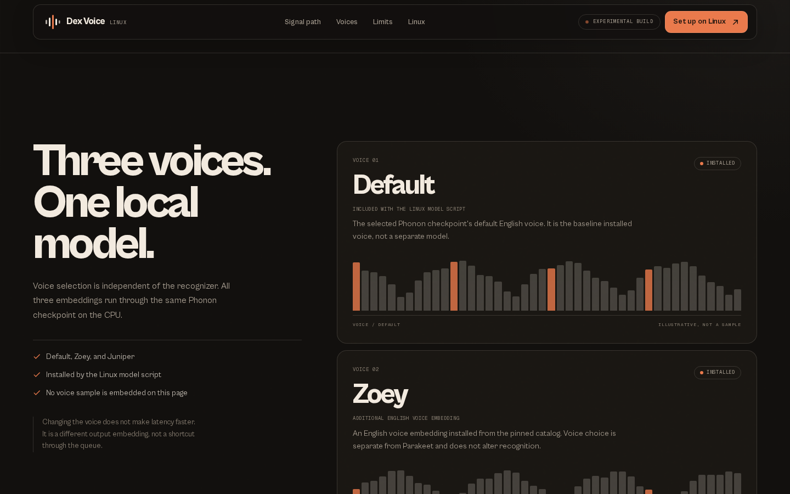
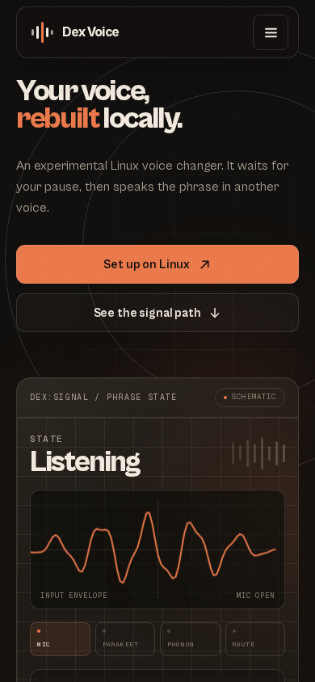

# Dex Voice

**A local, Linux-first speech bridge that re-synthesizes your microphone in a different voice before it reaches the call.**

Dex Voice is an experimental research prototype, not a product. It captures a physical
microphone, recognizes speech locally with Parakeet, synthesizes the recognized text with
a Phonon voice on the CPU, and publishes the result as a PipeWire virtual microphone that
Discord, Meet, or another calling application can select. Audio does not leave the machine,
and there is no account, telemetry, or hosted service.

The signal path works end to end on Linux, but the result is **not** a real-time
conversational voice changer. Speech is handled phrase by phrase after a pause, the bridge
is half-duplex, and output can fall behind long or overlapping speech. Read the
[limitations](#limitations) before trying it.



## What it does

- Captures a microphone you select explicitly, without changing system audio defaults.
- Recognizes English speech locally with the Parakeet Unified F16 GGUF through
  `transcribe.cpp` on Vulkan.
- Synthesizes recognized phrases with a Phonon English checkpoint and an installed voice
  embedding on the CPU. The recognizer and the voice are independent choices.
- Writes the synthesized PCM into a PipeWire null sink named `DexVoice`.
- Exposes that sink through a remapped source named `DexMicrophone`, so calling apps see a
  normal microphone rather than a raw monitor.
- Runs a Rune desktop interface that shows bridge state, the transcript, routing, and the
  app's own diagnostics.

## Signal path

```text
physical microphone
        |
        v
  cpal capture on PipeWire's PulseAudio host
        |
        v
Parakeet Unified F16 GGUF
  transcribe.cpp / ggml / Vulkan
        |
        v
  recognized, committed words
        |
        v
Phonon English checkpoint, CPU
  Default, Zoey, or Juniper voice
        |
        v
  PipeWire null sink: DexVoice
        |
        v
  remapped source: DexMicrophone
        |
        v
Discord / Meet / another application
```

Everything in that path is local. The virtual microphone is a deliberate remap: Discord and
some browsers hide plain `.monitor` sources, while a remapped source is listed like any
other capture device.

## Screenshots

The redesigned Rune interface, shown in its main states:

| Idle | Listening |
|---|---|
|  |  |
| **Speaking** | **Failed** |
|  |  |

Settings, including explicit model paths and device pickers:



The project website is a separate static showcase, not the application:



| Signal path | Voices |
|---|---|
|  |  |



## Repository layout

```text
rust/                 Rust workspace: desktop app, ASR, TTS, audio, core
  apps/dex-voice/     Rune desktop application
  crates/             dex-asr, dex-tts, dex-audio, dex-core
  scripts/            model installer, virtual microphone setup
  README.md           Rust build and runtime guide
  LINUX.md            Linux runbook and verified behavior
website/              Next.js showcase site (not the application)
src/dex_voice/        Python feasibility harness and earlier desktop prototype
tests/                Python tests for the harness
docs/                 Preserved harness notes and project screenshots
fixtures/             Reference transcript and word-alignment fixture
spike-results/        Native ASR spike reports (generated WAVs are not committed)
packaging/            Python/Windows packaging files
RESULTS.md            Measured harness results, including failed attempts
WINDOWS.md            Earlier Windows Python build notes
```

Model weights, generated audio, build output, Python environments, Rust targets, and
Node.js output are excluded from version control.

## Build and run on Linux

The Rust application is the current desktop implementation and is Linux-only. It needs:

- Rust with edition 2024 support (tested with Rust 1.98.1)
- CMake, Ninja, a C++17 compiler, and `glslc`
- The Vulkan loader, Vulkan drivers, and Vulkan/SPIRV headers at build time
- `libcblas` and `libpulse` development libraries
- An NVIDIA GPU selected explicitly through Vulkan

On distributions with the packages available:

```sh
sudo apt install libvulkan-dev spirv-headers glslc libcblas-dev libpulse-dev
```

Vulkan headers can also be vendored under `build/third_party/`; the exact clone and
CMake commands are in [`rust/README.md`](rust/README.md#prerequisites). `build/` is
ignored by git.

From `rust/`, install the pinned models and voices, create the virtual microphone, build,
and run:

```sh
cd rust
./scripts/install-models.sh
./scripts/setup-virtual-mic.sh
cargo build --release -p dex-voice
./target/release/dex-voice
```

The model installer verifies every file against a pinned SHA-256 before accepting it and
writes to `~/.local/share/dex-voice/models` by default. Set `DEX_MODELS` to use another
directory:

```sh
DEX_MODELS=/path/to/models ./target/release/dex-voice
```

In the application:

1. Open **Settings**.
2. Choose your physical microphone under **Microphone**.
3. Choose the **DexVoice** virtual sink under **Virtual microphone output**. Do not choose
   your speakers.
4. Choose **Default**, **Zoey**, or **Juniper** as the Phonon voice.
5. Save, press **Start**, and wait for **Listening** before speaking.
6. In the receiving application, select **DexMicrophone** as the microphone. Restart an
   application that was already running when the device was created, because most apps
   enumerate devices only at startup.

The application never changes your system default speaker or microphone. To remove the
virtual devices later, unload their PipeWire modules (see [`rust/LINUX.md`](rust/LINUX.md)).

The device-free self-test loads both models and processes an embedded fixture without
opening audio hardware:

```sh
./target/release/dex-voice --self-test self-test.json
```

It still requires a working Vulkan GPU. Full build flags, the streaming spike, and
troubleshooting are documented in [`rust/README.md`](rust/README.md).

## Models and voices

Nothing model-related is committed to this repository. The Linux installer downloads
pinned revisions and checks their hashes:

- **Parakeet Unified English F16 GGUF**, used by the recognizer.
- **Phonon English checkpoint**, used by the CPU synthesizer.
- **Default, Zoey, and Juniper** voice embeddings from the pinned Phonon voice catalog.

The Windows PowerShell installer (`rust/scripts/install-models.ps1`) provisions the
recognizer and the default voice for a clean Windows install of the Rust app, which has
not been built or tested on Windows. It does not install an audio driver; the earlier
Windows Python build expects a separately installed virtual cable.

Licensing follows the upstream projects. The Phonon English checkpoint is Apache-2.0; the
larger gated Phonon model variants are CC BY-NC 4.0 and are not bundled. Parakeet and the
voice catalog have their own model-card terms. Review those terms before redistributing
weights or generated audio. The Rust workspace manifest declares MIT; this snapshot does
not include a root LICENSE file.

## Website

The showcase is a statically rendered Next.js site. It is documentation and presentation
only; it never captures or plays audio and has no download or backend.

```sh
cd website
npm install
npm run dev      # local development
npm run build    # production build
npm run start    # serve the production build
```

Checks:

```sh
cd website
npm run lint
npm run typecheck
npm test
npm run test:e2e
```

See [`website/README.md`](website/README.md) for structure and deployment notes.

## Python feasibility harness

`src/dex_voice/` contains the original Python/ONNX harness and the earlier desktop
prototype. It is kept for reproducibility, not as the current application. It uses `uv`:

```sh
uv sync --python 3.12 --extra export
uv run dex-voice download
uv run --extra export dex-voice prepare-fp16
uv run dex-voice benchmark --output runs/pipeline-default
uv run pytest
```

The harness refuses to overwrite previous run directories and records detailed reports
under `runs/`, which is ignored by git. Its setup, experimental switches, and measurement
definitions are preserved in [`docs/PYTHON-HARNESS.md`](docs/PYTHON-HARNESS.md). The
measured outcomes, including configurations that failed, are in [`RESULTS.md`](RESULTS.md).

## Limitations

- **Research prototype, not a product.** There is no installer, package, hosted download,
  account, or support commitment.
- **Phrase-based, not word-by-word.** Dex Voice waits for a pause before sending a phrase,
  so it is not suitable for live back-and-forth conversation. Long uninterrupted speech is
  cut at a cap rather than streamed continuously.
- **Half-duplex.** The microphone is muted while Dex Voice plays, and speech that overlaps
  its own output is discarded. It will not talk over you.
- **No echo cancellation.** Use headphones. If another application plays DexMicrophone
  through speakers, the bridge can hear itself; the half-duplex guard reduces this but is
  not a substitute for echo cancellation.
- **Output can accumulate delay.** Synthesis can produce more audio than the source speech
  occupied, and the queue is bounded. Long speech can therefore fall further behind.
- **Linux-only Rust application.** There is no Windows Rust build and no tested Windows
  audio route for the Rust app. The earlier Windows Python build is a separate, older
  artifact and its CUDA and virtual-cable behavior was never validated on real Windows
  hardware.
- **Shutdown cleanup is unverified.** A crash has been reported when deliberately closing
  the application. Stop the bridge before closing the window, and keep a physical
  microphone available.
- **English only.** The installed recognizer and voices are English. Boundary trimming is
  experimental and can remove quiet consonants; disable it if speech sounds clipped.
- **No barge-in.** Speech already generated is not cancelled when you start talking again.
- **Settings are explicit.** Start refuses a blank output but cannot verify that the
  selected physical device is actually virtual. Selecting speakers sends synthesized
  speech to the room.

## Status

This is a research prototype and a snapshot of work in progress, not a release. The
architecture and the measured results are deliberately documented together: the pipeline
is useful as an experiment, but it does not meet the original conversational target, and
it should not be presented as a compliant real-time voice changer. The detailed
measurements and rejected attempts remain in [`RESULTS.md`](RESULTS.md),
[`spike-results/REPORT.md`](spike-results/REPORT.md), and [`WINDOWS.md`](WINDOWS.md);
they are not repeated here as product claims.

## Documentation

- [`rust/README.md`](rust/README.md) — Rust build, models, spike, and self-test
- [`rust/LINUX.md`](rust/LINUX.md) — Linux runbook and verified behavior
- [`RESULTS.md`](RESULTS.md) — measured Python harness results and limitations
- [`WINDOWS.md`](WINDOWS.md) — earlier Windows Python application
- [`website/README.md`](website/README.md) — showcase site
- [`docs/PYTHON-HARNESS.md`](docs/PYTHON-HARNESS.md) — preserved Python harness guide

## Third-party components

- Parakeet Unified by NVIDIA, via the upstream model card and GGUF conversion.
- `transcribe.cpp` and `ggml` for the native GGUF/Vulkan runtime.
- Phonon runtime and voices by Gradium.
- PipeWire, PulseAudio compatibility, and `cpal` for audio routing.
- Rune for the desktop interface.
- Next.js, React, GSAP, and Tailwind CSS for the showcase site.
- Cabinet Grotesk, self-hosted under the ITF Free Font License.

Each component keeps its own license and terms; consult the upstream projects before
redistributing code, weights, voices, or audio.
